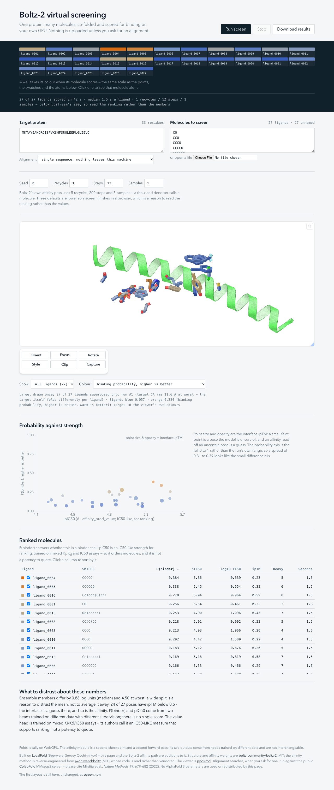

# Boltz2 Virtual Screening

One protein target, many ligands, scored in your browser. No install, no
server, no upload of your compounds — the model runs on your own GPU through
WebGPU.

**Live: https://pablo-arantes.github.io/boltz2-webgpu/bench.html**

Two front ends, one controller. `bench.html` is the current one: the screen is
drawn as a plate, one well per molecule, each well taking its score colour as
its result lands and isolating that molecule in the 3D view when you click it.
[`screen.html`](https://pablo-arantes.github.io/boltz2-webgpu/screen.html) is
the first layout, kept and unchanged
([screenshot](docs/assets/screening.png)). Both load the same `web/screen.js`, so
there is one run loop, one weight loader and one pair of affinity heads rather
than two of each. The design is written down, including what was discarded and
why, in [docs/BENCH-DESIGN.md](docs/BENCH-DESIGN.md).



## What it does

Paste a target sequence, give it a list of SMILES, and press Screen. For each
ligand it:

1. **co-folds** the target and the ligand together with
   [Boltz-2](https://github.com/jwohlwend/boltz) — the ligand is not docked
   into a fixed pocket, the complex is predicted from scratch;
2. **crops** to the binding site and runs Boltz-2's **affinity module**, a
   two-member ensemble that reads the predicted pose;
3. **superposes** the result on the first run, by Kabsch fit on the target's
   CA atoms, so every ligand sits in one frame and can be compared in the 3D
   view;
4. **ranks** the table and plots the two affinity outputs against each other.

The alignment, if you want one, is searched **once per target** and cached by
sequence hash — not once per ligand. You can switch it off entirely.

You get a sortable table, a scatter of the two scores, all poses in one 3D
scene, and a ZIP with the CSV, the plot and every structure.

## The two numbers, and why there is no third

Boltz-2's affinity module has two heads **trained on different data with
different supervision**. This tool keeps both, labels both, and never merges
them:

| | what it is | direction |
|---|---|---|
| `affinity_probability_binary` | a classifier: *is this a binder at all?* Trained on a binary binder/decoy label. The column for **hit discovery** — ranking a library. | 0..1, **higher is better** |
| `affinity_pred_value` | an **IC50-like** value on a log10 µM scale. Trained on a *mixture* of K<sub>i</sub>, K<sub>d</sub>, IC50, AC50, EC50 and XC50 across assay types, so it is not an IC50: Boltz-2's authors call it "a general measure of binding strength that supports ranking", to be "approximately interpreted as an IC50-like value" (paper, B.5.1). The column for **hit-to-lead** — comparing analogues, not quoting a potency. | **lower is better** |

`pIC50 = 6 − affinity_pred_value` is shown beside the value, because that is the
number a medicinal chemist reads, and it points the same way as the
probability (higher is better) — with the same caveat that it is a ranking
signal rather than a measured potency.

**The paper confirms five of this port's choices and corrects one label.**
Checked against `Boltz2_paper.pdf` (B.5.1, B.5.2): the affinity pass runs **5
recycling iterations**, coordinates come from **the best of 5 samples at 200
diffusion steps ranked by protein–ligand ipTM**, the module **masks out
intra-protein interactions**, it **mean-pools** over pairwise interactions, the
two ensemble members have **8 and 4 PairFormer layers**, and the binary head
averages the members' **likelihoods** rather than their logits — all of which
this port does, including two the review and this reading caught it *not* doing
earlier (5 samples rather than 3, and the pre-mask). What the paper corrects is
the *label*: calling the value column `log10(IC50)` overstated it.
**And the paper's molecular-weight correction disagrees with upstream's
code**: B.5.2 gives a linear `C1 · MW` term where `main.py` applies
`MW**0.3`. The coefficients were fitted to the code's form, so this port
follows the code — recorded at the coefficients so a reader checking against
the paper knows which way it was resolved.

The ensemble is **two members** and they can disagree a long way: measured here
on one ligand, `affinity_pred_value` **1.751 against 0.189** and
`affinity_probability_binary` **0.583 against 0.194**, for a mean of 0.970 /
0.389. So `…1` and `…2` are columns in the CSV and the page prints the median
and worst split under the table. A wide split is a reason to distrust the mean,
not to average it away.

Every affinity is reported with the **interface ipTM** of the pose it was read
from. A low-ipTM pose is a guess, and so is its affinity. The scatter draws it
as point size and opacity so that an unreliable prediction looks unreliable.

## Running it

Open the live link, or serve the repository yourself:

```bash
python3 tools/serve.py        # any static server will do; the page is static
# then open http://127.0.0.1:8080/bench.html   (or /screen.html)
```

**Requirements**

- A browser with **WebGPU**, which is not the same as a recent browser. What
  has it switched on by default:

  | Browser | Where | From version |
  | --- | --- | --- |
  | Chrome, Edge | Windows, macOS, ChromeOS | 113 |
  | Chrome | Android | 121 |
  | Chrome | Linux, Intel Gen12+ GPUs only | 144 |
  | Firefox | Windows | 141 |
  | Firefox | macOS, Apple silicon | 145 |
  | Safari | macOS 26, iOS 26, iPadOS 26 | 26 |

  🔴 **Linux is the one that catches people out.** Chrome did not enable WebGPU
  there by default until 144, and 144 only covers Intel Gen12+ — AMD and NVIDIA
  are still being rolled out. Below that, or on another GPU, it takes two flags:
  `chrome://flags/#enable-unsafe-webgpu` and `chrome://flags/#enable-vulkan`,
  then relaunch. `chrome://gpu` is the page that tells you where you stand.

  It can also be switched off on a machine that should have it: with "Use
  graphics acceleration when available" off in `chrome://settings/system`,
  Chrome renders in software and offers no WebGPU at all.

  If the page says it got no GPU, it now works out which of those cases you are
  in and prints the steps, with a diagnostics line to paste into an issue.

- A target the GPU can hold. The pair representation is
  `residues² × 128 × 4` bytes, so one tensor alone is 1.91 GiB at 2,000
  residues, and the trunk needs several of them at once. The hard ceiling is
  `sqrt(maxStorageBufferBindingSize / 512)` residues — **2,896** where the
  adapter reports 4 GiB, **2,047** where it reports 2 GiB — and the page reads
  your own device's limit, refuses above it before spending anything, and warns
  past the largest length measured here (297 residues).

  If your target is longer than that, crop it — see
  [Tips for a screen](#tips-for-a-screen), which is also where the measured
  cost per residue is.
- A **one-off weights download**, cached in CacheStorage afterwards: 365 MiB
  for the structure bundle, plus 6.5 MiB for the affinity module, fetched from
  a pinned Hugging Face revision. Nothing is installed and no weight lives in
  this repository.
- Optionally the network, for the MSA search described below.

Measured on a first visit with an empty cache: **50–104 s** to a usable page
depending on the connection, almost all of it the structure bundle, then a few
seconds per ligand at low sampler settings.

## Input: a `.smi` file

One ligand per line, SMILES first, an optional name after whitespace:

```
CCO                           ethanol
CC(C)Cc1ccc(cc1)C(C)C(=O)O    ibuprofen
CC(=O)Oc1ccccc1C(=O)O         aspirin
```

Blank lines and `#` comments are skipped. Paste the list into the box or drop
the file on the page. A ligand that will not parse is reported on its own row
rather than stopping the screen.

## Tips for a screen

### Crop the target to the domain that holds the site

🔴 **This costs you nothing in the score.** Boltz-2's affinity module reads
**at most 256 tokens, at most 200 of them protein, within 10 Å of the ligand** —
upstream's own `AffinityCropper` defaults, which this port follows exactly
(`shared/af3/affinity/crop.js`). Your full-length target never reaches the
affinity head. It only changes the structure the score is read off, and the
cost of folding it.

So cropping is the method, not a workaround. How to crop:

- **Keep the whole domain, not a shell around the pocket.** The crop is folded
  from scratch with no template, so it has to be something that folds on its
  own.
- **Keep both domains when the site sits between them.** HIV-1 protease is the
  clean example: the site is on the dimer axis, so a single monomer is the wrong
  crop. Kinase hinge sites and most protease clefts are the same shape of
  problem.
- **Check that the crop folded** before trusting any ranking from it: the
  per-ligand **ipTM** column, and the **target CA rms** in the line under the 3D
  view. A crop that does not fold consistently shows up as a large rms across
  ligands, and an affinity read off a bad pose is a guess.

What a length costs — one ligand, 1 recycle / 12 steps, M3 Pro:

| target | seconds a ligand | 100 ligands |
|---|---|---|
| 99 aa | 7.4 s | ~12 min |
| 198 aa | 20.9 s | ~35 min |
| 297 aa | 32.2 s | ~54 min |

Across that range the cost grows about as `residues^1.35`, because the
per-ligand fixed costs still dominate — **not** as the cube, which is the
asymptotic term. 297 residues is the largest length timed here, so the page
warns rather than predicts above it, and refuses above your GPU's own ceiling.
Don't read a 2,000-residue estimate off that table in either direction; the
memory arithmetic in [Running it](#running-it) is what rules that size out.

### Rank cheap, then measure the hits properly

The defaults (3 recycles / 100 steps) are already below Boltz-2's own affinity
settings of **5 recycles / 200 steps / 5 samples** — a thousand denoiser calls a
molecule — and the page says so under the controls. That is the right trade for
a first pass: screen the library low to get an **order**, then re-run the top
handful at upstream's settings before believing any individual number. The
status line repeats the settings used with every run so a screenshot cannot
lose them.

### Read the ranking, and read the ipTM beside it

- **P(binder)** answers "is this a binder at all". **pIC50** is an IC50-*like*
  strength for ordering congeneric molecules. They come from two heads trained
  on different data; there is no third number and the page will not invent one.
  [The two numbers](#the-two-numbers-and-why-there-is-no-third) has the detail.
- A **low ipTM** means the interface is a guess, and so is the affinity read off
  it. The scatter draws it as point size and opacity so an unreliable prediction
  looks unreliable.
- The **plate** at the top is one well per molecule, coloured on the same scale
  as the points, the table swatches and the atoms. Click a well to leave that
  molecule alone in the pocket.
- **What to distrust** at the bottom of the page is generated from your own run
  — the ensemble spread, how many poses are below ipTM 0.5 — not boilerplate.

### One connected molecule per line

A salt or co-crystal has no single binder to score, and the page refuses it by
name rather than guessing. `[Li+].[Li+].C(=O)([O-])[O-]` comes back as "this
ligand is 3 disconnected fragments (a "." in the SMILES). Affinity is predicted
for one molecule; split it, or remove the counter-ion." Strip counter-ions
before screening.

## What leaves your machine

The fold, the crop, the affinity forward pass, the superposition, the plots and
the ZIP all run in the tab. Two things can use the network and both are
visible:

- **The weights**, fetched once from the pinned Hugging Face revisions and
  cached by the browser.
- **The MSA search**, if you ask for it. The page loads with
  **Single sequence** selected and sends nothing; choosing MMseqs2 sends the
  target sequence to `api.colabfold.com` **once per target** — the a3m is cached
  in CacheStorage under a hash of the sequence and reused for every ligand and
  on the next visit.

**What MSA reuse does not save.** It removes the repeated search, which is
tens of seconds each. It does **not** let the trunk be reused: the ligand's
tokens enter the pair and MSA representations, so the trunk runs per ligand, in
both passes. No trunk embedding is cached and none should be.

## Benchmark: 9 approved inhibitors hidden among 100 drugs

The first check here against **experiment** rather than against upstream
Boltz-2. Target: HIV-1 protease, 99 residues, HXB2 wild type (UniProt P04585,
chain "Protease"). Ligands:
[`tools/fixtures/hiv1-protease-100.smi`](tools/fixtures/hiv1-protease-100.smi)
— 100 approved drugs, of which **9 are the approved HIV-1 protease
inhibitors**. Single sequence, no MSA, seed 0.

| ranking by | ROC AUC | 95% CI | EF at 1% | EF at 10% | median rank of an active |
|---|---|---|---|---|---|
| `P(binder)` | 0.762 | 0.540–0.935 | 11.1× | 4.4× | 11 of 100 |
| `pIC50` | 0.873 | 0.733–0.967 | 0× | 4.4× | 11 of 100 |

`P(binder)` puts **saquinavir, tipranavir and atazanavir first, second and
third** — an 11× hit rate in the top 1%. Six of the nine are in the top 20.

For scale, Boltz-2's own paper reports per-target AUROC between **0.64 and
0.92** (median 0.85) on its binary affinity benchmarks, so both numbers here
sit inside the range the method achieves natively — which is what you would
hope for from a port, since the ceiling is Boltz-2's, not this code's.

Reproduce with `python3 -I tools/benchmark_hiv1.py --screen=<run output>`.
Per-ligand ranks and the full analysis are in
[docs/MEASURED.md](docs/MEASURED.md).

**What this is and is not.** Nine actives on one target is a small set — hence
the wide intervals — and the decoys are approved drugs rather than
property-matched decoys, so part of the separation is chemical size rather than
recognition. It is a sanity check that the pipeline produces usable orderings,
not a validation of predictive power. A stronger evaluation needs
property-matched decoys, more actives and several targets.

## Speed, measured

**MacBook Pro, Apple M3 Pro** (11 cores: 5 performance + 6 efficiency, 18 GB),
Chrome/WebGPU. The 100-ligand screen above, end to end:

| | |
|---|---|
| per ligand, median | **22.8 s** |
| per ligand, range | 18.1 s – 31.9 s |
| 100 ligands | **39 minutes** |
| cold start (weights, empty cache) | 50 – 104 s |

Each ligand is a full co-fold plus the affinity pass: 3 recycles / 100 sampler
steps for the pose, then 5 recycles / 200 steps / 1 diffusion sample for the
affinity, on a 108–154 token crop (99 target residues plus the ligand). Time
tracks the crop: a median of 22.1 s under 125 tokens against 29.1 s at 145 or
more. Weights are fetched once (365 MiB structure + 6.5 MiB affinity) and
cached, so only the first visit pays the cold start.

## Status, and what the numbers are worth

The port is checked **against upstream PyTorch Boltz-2 itself**, not against
its own reference, which is what found four defects every self-consistent gate
here passed. With those fixed, both conditioning inputs the affinity module
reads sit at the int5 quantisation floor, and over six ligands the ranking
agrees with upstream at **rho +1.000** on the binder probability and **+0.886**
on the value head.

**That is agreement with upstream Boltz-2, NOT with experiment.** No
measured affinity has been compared to anything here. The live checks above run
at 20 sampler steps against upstream's 200, so they verify the pipeline rather
than prediction quality, and the page says so on its own results line.

- [docs/MEASURED.md](docs/MEASURED.md) — how it is checked, every measured
  number, and what is still wrong
- [spec/G8-RESULT.md](spec/G8-RESULT.md) — the full comparison against upstream,
  including the retractions
- [docs/PROVENANCE.md](docs/PROVENANCE.md) — the pinned revisions, what is
  ported from LocalFold and what is new here

## Licences

Three different things with three different owners. **This repository
redistributes no weights**: every bundle names the Hugging Face revision it
fetches from, and the weights travel from there.

- **LocalFold's code** — [Beerware](LICENSE) (Revision 42),
  © Sergey Ovchinnikov. Everything not listed as new above
  is LocalFold's, at the pinned commit.
- **Boltz-2's weights** — **MIT**, `boltz-community/boltz-2`. Both checkpoints,
  including the affinity module, and that is what makes this project possible.
  Upstream Boltz's code is MIT too; it is read here, not copied.
- **The AlphaFold 3 parameters in LocalFold's other exports carry DeepMind's
  own terms** — the
  [CC BY 4.0 parameters licence](https://github.com/google-deepmind/alphafold/blob/main/WEIGHTS_LICENSE)
  and DeepMind's Prohibited Use Policy. **Do not redistribute those.** They are
  not used by this screening path, which runs Boltz-2 only, and they are not
  redistributed here — but LocalFold's registry can fetch them and anyone
  publishing a build must keep them out of it.

If you use the MSA search, cite ColabFold (Mirdita et al., *Nature Methods* 19,
679–682, 2022). If you use the affinity predictions, cite Boltz-2; if you use
the structure stack, cite AlphaFold 3 and LocalFold.
