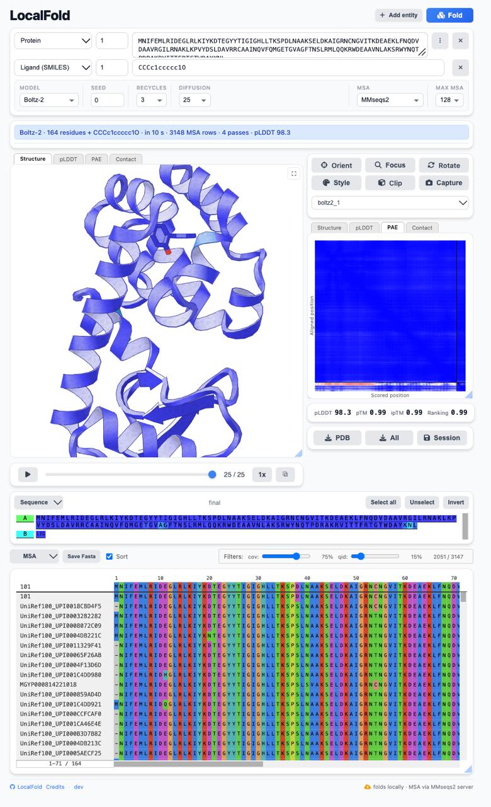

# Boltz-2 virtual screening in the browser

One protein target, many ligands, co-folded and scored for binding affinity
with **Boltz-2 on WebGPU** — in a browser tab, with nothing leaving the machine
except an optional MSA search.

Built by reverse-engineering [LocalFold](https://github.com/sokrypton/localfold)'s
WebGPU stack and extending it with Boltz-2's affinity module, which LocalFold
does not have.

This repository IS the working tree: a LocalFold clone at the pinned commit
below, with this project's work on top.

```
web/ shared/ webgpu/ webgl/ cpu/   the page and the backends (LocalFold's split,
                                   see README-localfold.md)
screen.html  web/screen*.js        the screening page - this project's own
spec/        the Phase 1 and Phase 2 reports, the pinned revisions, G0 and G8
notes/       the pinned LocalFold commit
tools/       every gate and probe, LocalFold's and this project's side by side:
             `g0_verify.py` (all 5,019 shared checkpoint tensors),
             `g8_compare.py` / `g8_localise.py` (against upstream PyTorch),
             `export_boltz2_affinity.py` (the affinity export), and readers that
             pull a tensor table out of a 2 GB remote checkpoint over HTTP range
             requests with a restricted unpickler, downloading nothing
refs/        NOT COMMITTED and not part of the deliverable: upstream clones,
             checkpoints and comparison outputs, fetched by
             `tools/fetch_boltz_cache.sh`
```



## Run it

```bash
python3 tools/serve.py           # or any static server; the page is static
# then open http://127.0.0.1:8080/screen.html
```

It needs a browser with WebGPU (current Chrome, Edge, Safari or Firefox) and
two weight bundles, both fetched from a pinned Hugging Face revision in
`MODEL_BUNDLES` and cached in CacheStorage - nothing to install and no weight
in this repository. The structure bundle is 365 MiB; the affinity bundle is
6.51 MiB in eight shards, fetched only when a reader asks for an affinity.

To rebuild the affinity export yourself rather than fetch it - which is how it
was produced, and what `tools/g0_verify.py` checks against the checkpoint:

```bash
# the export, if you do not already have it: 520 tensors read straight out of
# the remote checkpoint over HTTP range requests - no 2 GB download - then
# quantised and sharded by LocalFold's own pipeline.
python3 tools/export_boltz2_affinity.py --out=refs/export/boltz2-affinity-f32
python3 tools/quantize_af3.py --source=refs/export/boltz2-affinity-f32 \
                              --out=refs/export/boltz2-affinity-int5 \
                              --bits=5 --group=32
# the symlink FIRST: write_manifest_module.py resolves the export through
# `model-boltz2-affinity-int5`, the path MODEL_BUNDLES names.
ln -s refs/export/boltz2-affinity-int5 model-boltz2-affinity-int5
python3 tools/write_manifest_module.py boltz2-affinity
```

Paste a protein sequence, drop in a `.smi` file (or type one SMILES a line),
press **Screen**. Results stream in as each ligand finishes.

## Scope

**In:** one protein chain given as an amino-acid sequence, plus a `.smi` file of
ligands. Each ligand is folded with the target and scored on its own — Boltz-2
predicts affinity for **one** ligand at a time, so the sequential loop is not an
implementation convenience, it is the model's interface.

**Out:** protein–protein, nucleic acids, multi-ligand complexes. The page
refuses a ligand of more than 128 heavy atoms (upstream's own limit) and one
written as two disconnected fragments.

## The two numbers, and why there is no third

Boltz-2's affinity module has two heads **trained on different data with
different supervision**. This tool keeps both, labels both, and never merges
them:

| | what it is | direction |
|---|---|---|
| `affinity_probability_binary` | a classifier: *is this a binder at all?* Trained on a binary binder/decoy label. The column for **hit discovery** — ranking a library. | 0..1, **higher is better** |
| `affinity_pred_value` | an **IC50-like** value on a log10 µM scale. Trained on a *mixture* of K<sub>i</sub>, K<sub>d</sub>, IC50, AC50, EC50 and XC50 across assay types, so it is not an IC50: Boltz-2's authors call it "a general measure of binding strength that supports ranking", to be "approximately interpreted as an IC50-like value" (paper, B.5.1). The column for **hit-to-lead** — comparing analogues, not quoting a potency. | **lower is better** |

`pIC50 = 6 − affinity_pred_value` is shown beside the value, because that is the
number a medicinal chemist reads, and it points the same way as the
probability (higher is better) — with the same caveat that it is a ranking
signal rather than a measured potency.

🔴 **The paper confirms five of this port's choices and corrects one label.**
Checked against `Boltz2_paper.pdf` (B.5.1, B.5.2): the affinity pass runs **5
recycling iterations**, coordinates come from **the best of 5 samples at 200
diffusion steps ranked by protein–ligand ipTM**, the module **masks out
intra-protein interactions**, it **mean-pools** over pairwise interactions, the
two ensemble members have **8 and 4 PairFormer layers**, and the binary head
averages the members' **likelihoods** rather than their logits — all of which
this port does, including two the review and this reading caught it *not* doing
earlier (5 samples rather than 3, and the pre-mask). What the paper corrects is
the *label*: calling the value column `log10(IC50)` overstated it.
🔴 **And the paper's molecular-weight correction disagrees with upstream's
code**: B.5.2 gives a linear `C1 · MW` term where `main.py` applies
`MW**0.3`. The coefficients were fitted to the code's form, so this port
follows the code — recorded at the coefficients so a reader checking against
the paper knows which way it was resolved.

The ensemble is **two members** and they can disagree a long way: measured here
on one ligand, `affinity_pred_value` **1.751 against 0.189** and
`affinity_probability_binary` **0.583 against 0.194**, for a mean of 0.970 /
0.389. So `…1` and `…2` are columns in the CSV and the page prints the median
and worst split under the table. A wide split is a reason to distrust the mean,
not to average it away.

Every affinity is reported with the **interface ipTM** of the pose it was read
from. A low-ipTM pose is a guess, and so is its affinity. The scatter draws it
as point size and opacity so that an unreliable prediction looks unreliable.

## What leaves your machine

The fold, the crop, the affinity forward pass, the superposition, the plots and
the ZIP all run in the tab. Two things can use the network and both are
visible:

- **The weights**, fetched once from the pinned Hugging Face revisions and
  cached by the browser.
- **The MSA search**, if you ask for it. The page loads with
  **Single sequence** selected and sends nothing; choosing MMseqs2 sends the
  target sequence to `api.colabfold.com` **once per target** — the a3m is cached
  in CacheStorage under a hash of the sequence and reused for every ligand and
  on the next visit.

🔴 **What MSA reuse does not save.** It removes the repeated search, which is
tens of seconds each. It does **not** let the trunk be reused: the ligand's
tokens enter the pair and MSA representations, so the trunk runs per ligand, in
both passes. No trunk embedding is cached and none should be.

## Pinned revisions

**LocalFold** — this repository is a clone of this commit, and every "ported from
LocalFold" claim below is against this tree:

```
https://github.com/sokrypton/localfold
357518613af612b4e1e887deecd93bd612fdac76   2026-11-09
```

**Upstream Boltz** — read as a reference, never vendored:

```
https://github.com/jwohlwend/boltz
b1ebfc46ecf57f5414e0d1a6f9027bbb122c53bc   v2.2.1-6-gb1ebfc4
```

**Weights** — `boltz-community/boltz-2` at repo revision
`6fdef46d763fee7fbb83ca5501ccceff43b85607`:

| file | bytes | what |
|---|---|---|
| `boltz2_conf.ckpt` | 2,286,561,469 | structure; LocalFold's `boltz2` bundle derives from this |
| `boltz2_aff.ckpt` | 2,062,139,170 | affinity; **98.3 % redundant with the above** |
| `mols.tar` | — | CCD assets, **not needed** — SMILES-only scope |

🔴 **The two checkpoints share 5,019 tensors byte for byte.** Verified
exhaustively, not sampled, by `tools/g0_verify.py` (CRC-32 and size per
tensor from the ZIP central directory, escalating to sha256). That is why the
affinity bundle is **520 tensors, 6.4 MiB** rather than a second 500 M-parameter
export, and why no second trunk is downloaded.

## What is ported from LocalFold

Used as it stands, or adapted with its own gates still passing. None of this
was written here:

- **The whole weight pipeline** — `export_af3_model.py` → `quantize_af3.py` →
  `repack_shards.py` → `write_manifest_module.py`, the `MODEL_BUNDLES` registry
  with revision-pinned remotes, `HttpTensorStore` and its CacheStorage shard
  cache, and `build_site.py`'s digest verification. The affinity bundle goes
  through it unchanged: int5 asymmetric, group 32, float16 scale **and** zero
  point.
- **The AF3-lineage model** in its boltz2 dialect — trunk, MSA stack, diffusion
  sampler, confidence head, atom encoder, `target_feat`.
- **Every pair kernel the affinity stack runs on** — triangle multiplication in
  both directions (`webgpu/af3/trunk/triangle.js`), grid attention
  (`grid-attention.js`), the SwiGLU transition (`transition.js`). The affinity
  pairformer is a new *driver*, not new arithmetic.
- **The featuriser** — `shared/af3/featurise/`, including the `atomGathers`
  windowing rule and the dense-24 per-token atom layout.
- **SMILES** — the parser and the distance-geometry conformer builder in
  `shared/chem/`, gated against real RDKit over 74 molecules and 1,148
  re-writings.
- **The runtime** — `GpuBufferAllocator`, the memory budget and
  `GpuMemoryBudgetError`, weight residency and release, the pipeline cache that
  indexes by source, driver-reset recovery.
- **The MSA client** (`shared/input/mmseqs2-api.js`), the PDB writer, the ZIP
  writer, py2Dmol and its viewer DOM, and the Horn/Kabsch superposition in
  `web/pdb-superpose.js`.

## What is reverse-engineered from upstream Boltz

Written here, from reading upstream's source and holding the result to
upstream's own PyTorch output. **Nothing is vendored** — no upstream Python is
copied into this tree.

| upstream | ported to | lines |
|---|---|---|
| `modules/affinity.py` `AffinityModule.forward` | `cpu/af3/affinity/affinity.js` (f64 reference) + `webgpu/af3/affinity/affinity.js` | 458 + 253 |
| `modules/affinity.py` `AffinityHeadsTransformer` — **no transformer: 18 tensors of MLP** | the same pair | — |
| `layers/pairformer.py` `PairformerNoSeqModule` | `webgpu/af3/affinity/pair-stack.js`, a **pair-only driver** over LocalFold's kernels | 194 |
| `modules/encodersv2.py` `PairwiseConditioning` (Algorithm 21) | the same, over the transition kernel | — |
| `data/crop/affinity.py` `AffinityCropper` | `shared/af3/affinity/crop.js` | 220 |
| `data/feature/featurizerv2.py` `process_msa_features(affinity=True)` | `shared/af3/affinity/features.js` — the depth-1 profile | 104 |
| `center_idx` / `disto_idx` | `shared/af3/affinity/centre-atoms.js` | 122 |
| the crop's re-featurisation | `shared/af3/affinity/featurise-crop.js` | 253 |
| `data/parse/schema.py` MW and size limits | `shared/chem/molecular-weight.js` + `shared/chem/affinity-limits.js` | 220 + 96 |
| `models/boltz2.py` pre-mask, best-by-ipTM, ensemble, MW correction | `web/affinity-run.js` | 341 |
| the weight layouts | `shared/af3/weights/affinity-weights.js` | 323 |

**Deliberately not ported**, because upstream never runs them: `GaussianSmearing`,
`use_cross_transformer`, `groups`, and `transformer_args.{num_blocks,num_heads}`.
They are dead in the checkpoint this reads.

**One new kernel.** `webgpu/af3/affinity/pair-project.js` — a fused pair
LayerNorm + bias-free projection. It exists because measurement refuted the
argument that the host side could not matter: the host was ~10 s a ligand, and
this took a ligand from **16,673 ms to 2,332 ms**, with 82 % of that spent on
the GPU.

**New here, not from Boltz:** `shared/input/smi.js` (`.smi` intake),
`shared/input/msa-cache.js` (persisted alignment), `web/screen*.js` and
`screen.html` (the screening page, its scatter, table, scene and ZIP).

## How it is checked

Every gate is a `npm run` script at the repository root, with its own one-paragraph
description in `package.json` saying what it caught.

| gate | what it establishes |
|---|---|
| `test:affinity-mw` | the molecular weight agrees with **RDKit's** table, which is what the MW correction's coefficients were fitted against. Found this port's IUPAC-2021 table disagreeing with RDKit on **51 of 86 elements** — being more correct than RDKit is the bug here. |
| `test:affinity-quant` | the manifest's `float32Tensors` list actually protects the norms. `quantize_af3.py`'s `KEEP_FLOAT32` regex is slash-separated and upstream's names are dot-separated, so it matches **none** of them; without the list every LayerNorm scale would be int5. `--falsify` empties it and requires degradation. |
| `test:affinity-oracle` | the f64 reference computes upstream's function, seam by seam, against a dump of the **real module** (forward hooks on upstream's own `AffinityModule`). 9 real weight-swap mutations as a separation control. |
| `test:affinity-contract` | LocalFold's own pair kernels accept Boltz-2's weights. Five layouts pinned by measurement; each re-run with the wrong orientation and required to disagree. |
| `test:affinity-gpu` | the GPU pairformer computes the f64 reference's answer. **Found the incoming triangle's a/b order reversed** — `tri_mul_out` was exact at 1.0e-7 while `tri_mul_in` read 0.304, which the host gate could not see because its reference is outgoing-only. |
| `test:affinity-forward` | the whole function — LayerNorms, projections, broadcast sum, distogram, conditioner, stack, pooling, all three heads — against upstream's dump. |
| `test:affinity-crop` | an **exact index-set** comparison against upstream's `AffinityCropper` over 12 cases reaching all three break conditions. |
| `test:affinity-sinputs` | upstream's `affinity=True` substitution reaches `s_inputs`, and only through the profile. |
| `test:affinity-project` | the new fused kernel against a reference written in the gate. Its falsify input needs rows whose **variance is the size of eps**, because the convention is invisible at variance ≈ 1 *and* at variance exactly 0 — the control missed it twice before the input could express it. |
| `test:affinity-keys` | the affinity stack does not collide with the trunk in one pipeline cache, in both orders. The shapes are identical (128 channels, 4 heads of 32). |
| `test:affinity-memory` | the screening loop does not leak GPU memory across ligands. Two phases, because growth across ligands of *different sizes* is correct behaviour. |
| `test:boltz2-featurise` | the batch agrees with **upstream Boltz's own featuriser** — a reference this port did not have, since `test:batch` compares against the AF3 featuriser this port derives from. Needs no CCD and no 1.86 GB `mols.tar`. |
| `test:screen-page` | the **page**, driven through its own controls. Caught `uniqueIds` returning ids rather than entries (every job `id: undefined`) and py2Dmol silently overwriting the page's status line. |
| `npm test` / `test:boltz2-method-class` | pins boltz2's method conditioning class against upstream's published table. It exists because a wrong constant here moved a predicted IC50 by a factor of 2.2 and no per-token differential could see it — the row is added identically to every token. Fails 3/3 with the fix reverted. |
| `npm run bench:g8` | the whole pipeline against **upstream Boltz running the same job** — the one thing the function-level gates cannot see, since they compare a function to a function on identical input. Not a CI gate: upstream runs on CPU here, ~2 minutes a seed, and needs 6.1 GB of its own assets. **It found a systematic 0.343 log-unit gap that every other gate missed.** |
| `python3 tools/check_readme_claims.py` | this README's own checkable claims — the pinned SHAs against `spec/PINNED_COMMIT.txt`, every file path it names, every gate it lists, the licence text, and the affinity bundle's tensor and shard counts. It caught this file claiming 6.5 MiB where the manifest says 6.4. |
| `npm test` | 1,704 unit tests (1,703 pass, 1 skipped), including the `.smi` parser, the run loop's stop/resume and failure paths, the CSV/ZIP, the superposition and the MSA cache. |

## Measured

On an M2 (`apple / metal-3`), a 33-residue target, cropping to 36–46 tokens:

| setting | per ligand |
|---|---|
| 1 recycle / 12 steps / 1 sample | **1.7 s** |
| 3 / 100 / 1 | **6.0 s** |
| 5 / 200 / 3 | **22.8 s** |
| 3/200/1 then 5/200/5 — **upstream's own settings, both passes** | **34.6 s** |

Bundles: 365 MiB structure (24 shards) + 6.4 MiB affinity (8 shards, 33 MiB
decoded). GPU memory across a run: resident **19 MiB flat**, peak **727 MiB**;
with buffer pooling disabled the same loop grows **492 MiB a ligand**, which is
the failure the gate exists for.

🔴 **Upstream's own settings are 3/200/1 for the structure pass and 5/200/5
for the affinity pass**, and the second half of that was recorded here as
5/200/**3** until the G8 work read it off the CLI rather than the function
signature: `predict`'s signature says `diffusion_samples_affinity: int = 3`,
its click option says `default=5`, and click passes its value — so a plain
`boltz predict` runs five. The same question had already been answered the
other way for the molecular-weight correction, where this port deliberately
follows the CLI.

🔴 **Step count is not a free knob.** At 4 sampler steps the ligand comes out as
a collapsed blob (ethanol's three atoms within 0.4 Å); at 50 it is a molecule
(C–C 1.46 Å, C–O 1.34 Å against ideals of 1.52 and 1.43) on a backbone with
CA–CA median 3.818 Å. The page defaults below upstream's settings and says so on
its own status line.

🔴 **The superposed scene carries the target's own variation.** Each ligand is
co-folded with its own copy of the target, so Kabsch alignment on the target's
CA atoms removes the frame but not the conformational difference. Two ligands at
50 steps: **24.16 Å rms apart before the fit, 4.14 Å after** (worst 44.55 →
8.27). Three ligands at 3 recycles / 100 steps: residuals of **0.745 Å and
8.814 Å** against run #1, with the ligand centroids 9.2–14.1 Å apart. The page
prints the worst residual rather than letting a reader compare poses to a
precision the data does not have.

## Known limits

- **The affinity bundle has no published remote.** `MODEL_BUNDLES` names a local
  directory, so a deployed site would 404; `build_site.py` treats the page as
  optional for that reason. Publishing the export and pinning its revision is a
  one-line change in the registry.
- 🔴 **Neither output is upstream's yet, and which one is closer depends on the
  question.** G8 — `npm run bench:g8`, upstream's own checkpoints on CPU
  against this port — found a systematic gap and localised it to two inputs.
  One is **fixed**: this port fed method conditioning class 1 (X-ray
  diffraction) where genuine Boltz-2 feeds 4 (de novo), a constant 384-vector
  on every token; that took `s_inputs`'s protein tokens to the int5
  quantisation floor. The other is **not**: a SMILES ligand's **atom names**,
  256 of the atom encoder's 388 input columns, where upstream uses RDKit's
  canonical rank over the hydrogen-bearing molecule (`C20 C22 … O13`) and this
  port uses AF3's per-element counter (`C1 … O1`) — **not one of ten names
  agrees**. Substituting upstream's names takes the atom encoder's ligand half
  from relRMS **1.1556 to 4.48e-2**, the quantisation floor, so the names are
  the whole of what is left.
- 🔴 **Measured across six chemically varied ligands, not one, and re-measured
  after two defects were fixed:**

  | Spearman ρ vs upstream | first measured | + review fixes | **+ atom names and the bond code** | discordant |
  |---|---|---|---|---|
  | `affinity_pred_value` / pIC50 | −0.03 | +0.31 | **+0.886** | 8 → 5 → **2 of 15** |
  | `affinity_probability_binary` | +0.89 | +0.89 | **+1.000** | 2 → 2 → **0 of 15** |

  🔴 **BOTH HEADS RANK NOW, AND THE VALUE HEAD'S "DOES NOT RANK" VERDICT IS
  RETRACTED.** It was true of every state measured before the SMILES atom names
  and the bond-type code were fixed; with both, aspirin goes 1.0201 → 1.5561
  against upstream's 1.5887, ethanol 2.3878 → 1.4400 against 1.4100, and
  nicotine 1.5061 → 0.9977 against 0.8530.

  🔴 **AND THE TWO REMAINING INVERSIONS ARE WEIGHED AGAINST UPSTREAM'S OWN SEED
  SPREAD, NOT COUNTED.** Its half-range on this target is 0.0570 log units.
  `propylphenol/naphthol` are **0.0165 apart in upstream's own numbers** — well
  inside that, so upstream does not resolve them at one seed and neither side
  can be said to have them the wrong way round. `ibuprofen/nicotine` are 0.0771
  apart, outside it, and that one is a genuine inversion.

  🔴 **AND n = 6 IS STILL SMALL, WHICH THE ρ DOES NOT HIDE.** At six ligands
  +0.886 sits essentially ON the 5% two-tailed critical value, so it is a real
  but thinly supported correlation; +1.000 is p ≈ 0.003. The ranking control is
  also **one upstream seed per ligand**, so it carries no spread of its own —
  the per-ligand numbers are compared against a single draw.
- 🔴 **Two science defects were found by a cold code review and fixed, and they
  invalidated the measurement above until it was re-run.** Both were in the
  composition, which every function-level gate is blind to by construction:
  * the affinity module's distogram was fed `fold.positions`, which is indexed
    by dense **atom slot** (`token*dense + atom`), where the module indexes one
    coordinate **per token** — so it read the first ~11 tokens' atoms, masked
    slots included, as if they were 256 token centres. It now receives
    `fold.pseudoBeta` (the disto gather, `tokens*3`). The float64 reference
    asserted this contract and threw; the GPU path had no length check, and now
    has one.
  * the trunk pair was handed over **unmasked**, directly below a comment
    claiming it was masked. Upstream applies `z * cross_pair_mask` before the
    module's LayerNorm and projections; the dump tool did and the page did not,
    so the two disagreed about the module's own input.

  Fixing both moved one ligand's value 1.3596 → 1.1708 and its probability
  0.3321 → 0.2964 (upstream 1.3541 ± 0.057, 0.2243 ± 0.009). **The classifier's
  ρ did not move at all** — the same two pairs invert — which says its ordering
  is robust to both defects and is driven by what reaches it through
  `s_inputs`. That is where the atom-name difference lives, so the attribution
  below survives the re-measurement; it was **not** safe to assert before it.
- 🔴 **The blocker that made this "not shippable as a screening tool" is now
  closed, and it was closed the way it was stated.** Reproducing RDKit's
  `CanonicalRankAtoms` was called required rather than optional, gated on exact
  integer agreement over the 74-molecule corpus: `npm run test:canonical-rank`
  is **74/74** and `npm run test:canonical-names` carries the names through the
  page's own parser. Fixing it, together with an off-by-one in boltz2's
  bond-type embedding index, took the module's two conditioning inputs to the
  int5 quantisation floor (`s_inputs` 4.38e-2 against a floor of 4.14e-2; `z`
  3.10e-2 against 3.04e-2, from 2.00e-1) and both affinity heads to the
  rankings above. What is still NOT established is agreement with EXPERIMENT:
  every number here is agreement with upstream Boltz-2 on one 33-residue
  target, single-sequence, over six ligands.
- 🔴 **The method-class fix changes every boltz2 structure fold too**, since
  `target_feat` is shared: pLDDT 87.9 → 82.9 and pTM 0.666 → 0.525 on one
  target, while the ligand gate's bond rms improves 0.062 → 0.049 Å. Less
  confident, more correct — but **no RMSD against a known structure has been
  measured either way**, and that is the outstanding check on the change.
- **`s_inputs` is not compared to upstream's embedder elementwise.** The
  substitution is shown to reach the output and to move only where it should;
  comparing the embedder itself needs upstream's whole featuriser stood up.
- The scene is handed to py2Dmol as one concatenated structure per update, so
  show/hide is a redraw. Cheap for hundreds of small ligands, wrong for
  thousands.
- A 33-residue test target has no real pocket. The ligand placements measured
  above are a plumbing result, not a docking result.

## Publishing

The site builds and deploys from `main` through
`.github/workflows/pages.yml`.

- 🔴 **THE DEPLOY REFUSES A SITE WITH NO SCREENING PAGE, WHICH IS THE ONE
  FAILURE THAT WOULD LOOK LIKE SUCCESS.** `screen.html` opens the
  `boltz2-affinity` bundle through `openStore`; while that bundle's `remote`
  was null, `bundleBaseUrl` fell back to `./model-boltz2-affinity-int5/` - a
  local export the build deliberately never copies - and every visitor would
  have 404'd on shard zero. `tools/build_site.py` drops an unservable page and
  says so, the same rule it already applied to an unservable model `<option>`
  one control further out, and the workflow turns that into a failed build.
  Watched failing both ways before being trusted: with the remote null the page
  is dropped and the deploy refuses, with it pinned the page ships and nothing
  is dropped.

- 🔴 **AND IT REFUSES ANY ROOT-ABSOLUTE REFERENCE**, because a project page is
  served from `/<repo>/` and a single `/`-rooted asset, worker, WASM or
  manifest path is the usual reason a fork 404s on Pages. `dist/` is entirely
  relative; the workflow fails if that stops being true, so no base-path
  rewriting step is needed and none is guessed at.

- 🔴 **THE AFFINITY BUNDLE IS PINNED TO A REVISION, NOT A BRANCH.** 6.51 MiB in
  eight shards plus the manifest at
  `pabloarantes/boltz2-webgpu-weights@adf393c7`, fetched only when a reader
  asks for an affinity. `resolve/<sha>/` cannot change under a visitor where
  `resolve/main/` would re-point on any re-upload. Verified as a BROWSER sees
  it rather than as an upload tool reports it: fetched with a
  `https://pablo-arantes.github.io` Origin, `access-control-allow-origin`
  echoed back on both the redirect and the file, and the bytes compared against
  the local export - manifest and shard zero identical. `python3
  tools/check_remote_bundle.py boltz2-affinity` finds all 8 shards.

  The export itself is checked against the float32 one by
  `tools/check-affinity-quantisation.py --f32=model-boltz2-affinity-f32
  --int5=model-boltz2-affinity-int5`: norms and output projections byte-exact,
  the large projections at 3.88e-2, which is int5's own level.

- 🔴 **NO WEIGHTS ARE TRACKED, AND ONE OVERSIZED FILE IS - DECLARED, NOT
  HIDDEN.** `npm run test:sizes` (`tools/check_repo_sizes.py`) fails on any
  tracked file over 10 MiB that is not declared with a reason, and fails again
  if a declared one leaves the tree, so the brief's "report anything over
  ~10 MB before committing" is a gate rather than a promise. Today: **1536
  tracked files, 70.1 MiB**, one file over the limit -
  `oracle-dumps/af3-6mrr.json` at 18.5 MiB, AlphaFold 3's own featurised batch
  for 6MRR, inherited from LocalFold and read by four tools. It is **not
  published**: the same gate checks `dist/` and finds nothing over the limit
  there, so it costs a visitor nothing.

- 🔴 **NOTHING NEEDS COOP/COEP.** No `SharedArrayBuffer` and no threaded WASM,
  so the headers GitHub Pages cannot set are not required.

## Licences

Three different things with three different owners. **This repository
redistributes no weights**: every bundle names the Hugging Face revision it
fetches from, and the weights travel from there.

- **LocalFold's code** — [Beerware](LICENSE) (Revision 42),
  © Sergey Ovchinnikov. Everything not listed as new above
  is LocalFold's, at the pinned commit.
- **Boltz-2's weights** — **MIT**, `boltz-community/boltz-2`. Both checkpoints,
  including the affinity module, and that is what makes this project possible.
  Upstream Boltz's code is MIT too; it is read here, not copied.
- 🔴 **The AlphaFold 3 parameters in LocalFold's other exports carry DeepMind's
  own terms** — the
  [CC BY 4.0 parameters licence](https://github.com/google-deepmind/alphafold/blob/main/WEIGHTS_LICENSE)
  and DeepMind's Prohibited Use Policy. **Do not redistribute those.** They are
  not used by this screening path, which runs Boltz-2 only, and they are not
  redistributed here — but LocalFold's registry can fetch them and anyone
  publishing a build must keep them out of it.

If you use the MSA search, cite ColabFold (Mirdita et al., *Nature Methods* 19,
679–682, 2022). If you use the affinity predictions, cite Boltz-2; if you use
the structure stack, cite AlphaFold 3 and LocalFold.
